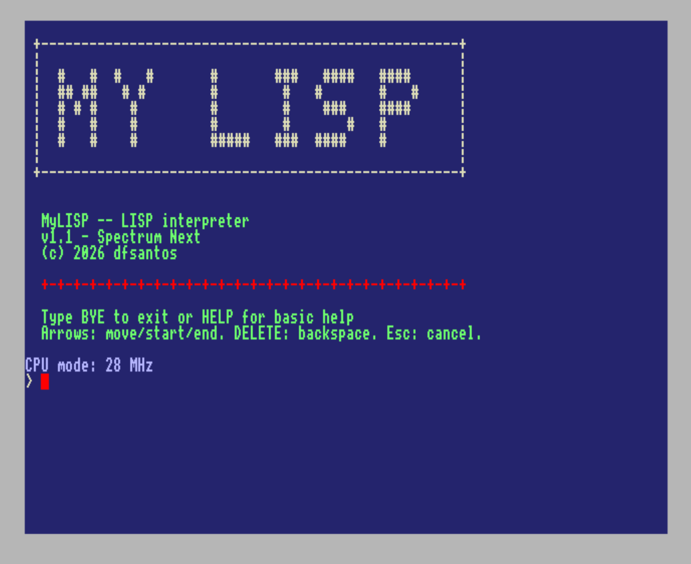
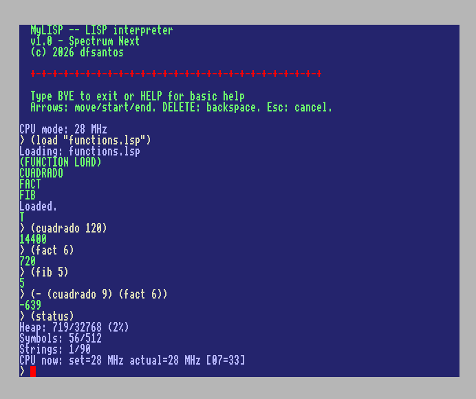

# MyLISP for ZX Spectrum Next — v1.1

MyLISP is a LISP-1 interpreter for the ZX Spectrum Next, written in C with
z88dk for NextZXOS. It includes lexical closures, an iterative evaluator,
paged memory, garbage collection and symbolic algebra examples.

It shares its design with the original [Sinclair QL version](https://github.com/dfernande132/MyLISP).



## Download and run

You need a ZX Spectrum Next running NextZXOS, or a compatible emulator such
as CSpect. No compiler is needed to run the supplied executable.

1. Download the repository using **Code → Download ZIP**, or download the
   binary package from Releases when available.
2. Copy `build/MyLISP.nex` and the `.lsp`/`.LSP` files from `examples/` into
   the same directory on your SD card or emulator filesystem.
3. Launch `MyLISP.nex` from the NextZXOS browser.
4. Type `HELP` for paginated help. Type `BYE` to finish.

```lisp
(+ 3 4)
(LOAD "CAS.LSP")
(LOAD "PCAS.LSP")
(STATUS)
```

The normal build requests 28 MHz. Startup reports the effective speed returned
by the machine. All code banks are included in the NEX; no separate bank files
are needed. BYE displays the farewell and stops in a final loop; it does not
return to BASIC. Use your usual restart procedure.

## Build from source

Requirements: Python 3 and a configured z88dk installation with the ZX Spectrum
Next classic target and esxDOS support. Put `zcc` and the other z88dk tools in PATH.

Reference compiler: `v25115-da80b5fe32-20260716`, source revision
`da80b5fe32839b8bd7935ade92e1644f05e8a8f0`. Other versions may produce different
code sizes or require adjustments.

Run from the project root:

```sh
python build.py
```

Use `python3 build.py` where Python 3 is named python3. The script creates
`build/` and generates `build/MyLISP.nex`, maps and intermediate files. It does
not require the internal development tests or documentation.

In VS Code, open the folder and press **Ctrl+Shift+B**. The task uses the same
source list. The supplied `build/MyLISP.nex` keeps the output directory present;
if you delete that directory, run build.py to recreate it.

Do not compile every C file at once: the wrappers in `src/bancos/` already
include several original modules and would cause duplicate definitions.

## Repository contents

| Path | Contents |
|---|---|
| `src/` | Interpreter, platform code and bank wrappers. |
| `.vscode/tasks.json` | Normal z88dk build configuration. |
| `build.py` | Python build entry point for Windows/Linux. |
| `build/MyLISP.nex` | Ready-to-run executable. |
| `examples/` | User programs and regression examples. |
| `doc/` | Technical reference, Spanish (`REFERENCIA_TECNICA_NEXT.md`) and English (`TECHNICAL_REFERENCE_NEXT_EN.md`). |
| `screenshots/` | Images used by this README. |
| `LICENSE` | MIT license for sources and build configuration. |

Only the normal executable is distributed. Internal development history,
GC test fixtures and intermediate files are excluded from the public repository.

## Examples

- `BASIC.lsp`: types, lists and basic language examples.
- `FUNCTION.lsp`: user functions, including factorial and Fibonacci.
- `SORT.lsp`: recursive sorting.
- `ORDEN.lsp`: higher-order functions.
- `DERIVA.lsp`: symbolic differentiation.
- `CAS.LSP`: symbolic algebra and simplification.
- `PCAS.LSP`: examples and checks to run after CAS.LSP.
- `REGRESS.LSP`: language checks, including deliberate error cases. Inspect
  individual checks as well as the final message.



## Keyboard and commands

- Left/right move the cursor; typing inserts text.
- Up/down or Ctrl+A/Ctrl+E move to the start/end of the line.
- Spectrum DELETE erases the previous character; Ctrl+DELETE erases under cursor.
- Enter accepts a physical line. Expressions can continue across lines.
- Esc or CAPS SHIFT+SPACE cancels input or requests evaluation cancellation.
- `HELP` pauses every 20 content lines; press a key to continue. `(HELP)` also works.
- `(CLEAN)` collects garbage; `(STATUS)` reports resource usage and CPU status.
- `(SYMBOLS)` lists user definitions.
- `(NEW)` asks for confirmation and resets the session. Use it directly at
  the prompt; nested use is rejected.

Cancellation is cooperative: an individual primitive, printing operation,
GC pass or blocking I/O may finish first. Effects already performed are retained.

## Limits and known limitations

| Resource | Limit |
|---|---:|
| Heap | 32,768 cells of 8 bytes in 32 physical pages of 8 KB. |
| Distinct symbols | 512. |
| Simultaneous string entries | 90. |
| Symbol name | 8 characters; longer names are truncated. |
| String | 36 characters; longer strings are truncated. |
| Complete expression | 500 characters. |
| Evaluation task stack | 8,192 tasks. |
| Parser nesting (parentheses and quotes) | 40 levels; deeper gives `ERR: nested too deeply`. |
| Nested `EVAL` | 5 levels; deeper gives `ERR: EVAL nested too deeply`. |
| `EQUAL` nesting | 32 levels; deeper gives `ERR: nested too deeply`. |
| Printer nesting | 64 levels; deeper levels are printed as `...`. |

User-level recursion does not use the Z80 stack: the iterative evaluator keeps
its pending work in the task stack. Parsing, printing, `EQUAL` and GC marking
still use C recursion, so each has a depth limit (table above) that keeps the
native stack within its reserve. `APPEND` is iterative.

Automatic GC runs between expressions, at 80% occupancy in the REPL and 50%
during LOAD, considering heap cells and string entries. A single expression
can exhaust resources before the next collection point. After detected resource
exhaustion, the expression is abandoned, GC runs and control returns to the prompt.
Valid global definitions are retained; the expression is not retried.

GC reclaims unreachable cells and strings, but not interned symbols. Use NEW to
clear the symbol table. `LOAD` cannot be nested: a `LOAD` inside a file that is
being loaded is rejected with `ERR: nested LOAD` (the reader shares state). A `LOAD`
typed at the prompt, or reached through `EVAL` (up to 5 levels), is fine.

## Numbers

Integers are 32-bit signed (±2,147,483,647). Rationals are exact: `(/ 1 3)` is `1/3`,
`(/ 4 6)` is `2/3`, `(+ 1/2 1/3)` is `5/6`, and a rational literal is normalized when
read (`4/8` is `1/2`, `6/3` is `2`). Results are always reduced and collapse to an
integer when the denominator is 1. `+ - * /` and the comparators `= < > <= >=` accept
integers and rationals; comparisons are exact (`(= 1/3 0.3333)` is `NIL`). A result that
would leave the 32-bit range gives `ERR: overflow` instead of a wrong number.
Floating point (native z88dk, 6 bytes) appears only when a literal has a decimal point,
and one float operand makes the whole operation float. `DIV` and `MOD` take integers only.

## Memory map and banked calls

The Z80 sees a 64 KB address space. The Next's MMU divides it into eight
8 KB slots, each of which can expose a different physical RAM page. MyLISP
uses **separate windows for paged data and paged code**, while keeping the
native stack in a fixed slot.

### CPU address space

| CPU addresses | MMU slot | Use |
|---|---|---|
| `$0000–$3FFF` | MMU0–1 | System/ROM area, outside MyLISP's linked program. |
| `$4000–$5FFF` | MMU2 | Temporary window for heap cells, symbol/string tables and evaluation tasks; restored to screen page 10 after access. |
| `$6000–$7FFF` | MMU3 | Screen memory, including the console's tilemap; not used as a heap window. |
| `$8000–$BFFF` | MMU4–5 | Resident code, libraries and bank-call trampolines. |
| `$C000–$DFFF` | MMU6 | Switchable code/resource window: physical pages 90–95. |
| `$E000–$FFFF` | MMU7, fixed | Ordinary constants, global/static data, BSS and the descending native Z80 stack. |

```text
CPU address space                    Physical pages selected as needed

$FFFF  +-------------------------+
       | Native stack, grows down|   MMU7 stays fixed
$F53E  +-------------------------+   Current static end (exclusive)
       | Fixed RODATA / DATA / BSS|
$E000  +-------------------------+
       | Code/resource window    | <--- 90 eval       93 banner/help
       |          MMU6           |      91 evaluator  94 GC
$C000  +-------------------------+      92 lexer+math 95 keyboard
       | Resident code, libraries|
       | and call trampolines    |
$8000  +-------------------------+
       | Screen / tilemap        |
$6000  +-------------------------+
       | Paged data window MMU2  | <--- 49 tables, 50–81 heap, 82–89 tasks
$4000  +-------------------------+
       | System / ROM            |
$0000  +-------------------------+
```

The current normal build has 15,432 bytes of resident code below `$C000`,
5,438 bytes of fixed constants/data/BSS from `$E000`, and a **nominal native
stack margin of 2,753 bytes** up to the configured SP of `$FFFF`. These are
link-map figures, not a guarantee of free stack during every operation.
Rebuilding with another compiler revision may change them.

### Physical RAM pages

Page numbers below refer to **8 KB physical pages**, not CPU addresses.

| Physical page(s) | Allocation | Contents |
|---|---:|---|
| 49 | 1 × 8 KB | 512 symbols × 9 bytes + 90 strings × 37 bytes: 7,938 bytes used, 254 free. |
| 50–81 | 32 × 8 KB | 32,768 heap cells × 8 bytes: 256 KiB. |
| 82–89 | 8 × 8 KB | 8,192 evaluation tasks × 8 bytes: 64 KiB. |
| 90 | 1 × 8 KB | Evaluation entry, environments and primitives (`eval.c`); 4,790 code bytes. |
| 91 | 1 × 8 KB | Iterative evaluator (`eval_iterativo.c`); 4,355 code bytes. |
| 92 | 1 × 8 KB | Lexer (`lexer.c`) and exact arithmetic (`aritmetica.c`, `racional.c`); 6,819 code bytes. |
| 93 | 1 × 8 KB | Banner and help text; 2,215 resource bytes. |
| 94 | 1 × 8 KB | Garbage collector (`gc.c`); 1,303 code bytes. |
| 95 | 1 × 8 KB | Keyboard, line editing and display setup (`teclado_next.c`); 2,027 code bytes. |

The evaluation task stack is separate from the native Z80 stack. Heap objects
are addressed by cell indices, not permanent pointers into the MMU2 window.
Data access routines disable interrupts while changing MMU2 and restore its
screen mapping before enabling them again.

NEX files group memory into **16 KB banks**: physical pages 90/91 are NEX
bank 45, 92/93 are bank 46, and 94/95 are bank 47. The linker/app builder
includes the required code/resource pages in the executable. The table, heap
and task pages are initialized and used at runtime; no external bank files
are loaded by the user.

### How z88dk links the banks

The project uses explicit C trampolines rather than relying on an automatic
banked-call convention. For example,
[`src/bancos/banco_eval.c`](src/bancos/banco_eval.c) selects a code section,
renames its public implementations and includes the original module:

```c
#pragma codeseg CODE_PAGE_90
#define Eval Real_Eval
/* Other public entry points are renamed in the same way. */
#include "../eval.c"
```

The build task passes the corresponding z88dk linker origin:

```text
-pragma-define:CRT_ORG_PAGE_90=0xC000
```

Pages 91–95 also use `$C000` as their origin. They occupy the same CPU
window at different times. Ordinary RODATA/DATA/BSS remain fixed above
`$E000`, as arranged by [`src/mapa_alto.asm`](src/mapa_alto.asm). The banner
and help are deliberate exceptions: their text belongs to `RODATA_PAGE_93`
and is read only while that resource page is visible.

### Calling through resident trampolines

C callers use the normal API, for example `Eval(expr, env)`. Its resident
wrapper in [`src/bancos_codigo.c`](src/bancos_codigo.c) performs the switch:

```c
CellIdx Eval(CellIdx expr, CellIdx env) {
    unsigned char antes = CodigoPaginaActual;
    CellIdx resultado;
    SeleccionarCodigo(90);
    resultado = Real_Eval(expr, env);
    SeleccionarCodigo(antes);
    return resultado;
}
```

`SeleccionarCodigo()` writes MMU6 using z88dk's `ZXN_WRITE_MMU6(page)` and
tracks the visible page. The saved page is an automatic local variable,
so each invocation can restore its own caller's mapping. Calls can nest:

```text
Resident Eval gate → page 90: Real_Eval
  → resident EvalIterativo gate → page 91: Real_EvalIterativo
    → resident AplicarBuiltin gate → page 90: Real_AplicarBuiltin
    ← restore page 91
  ← restore page 90
← restore the original page
```

The wrappers preserve the C signatures, including fastcall arguments and
long return values. Callers and function tables must use resident entry
points when crossing banks; calling a bank's `Real_*` implementation directly
would bypass the mapping. Interrupt handlers must not change MMU6 or depend
on code/data in its switchable window. MMU7 remains fixed throughout, so
switching code pages never removes the active native stack.

## License and distribution

The source code in `src/`, `build.py` and `.vscode/tasks.json` is provided under
the [MIT license](LICENSE).

The supplied binary and documentation retain their Freeware terms: use for any
purpose, including commercial projects, and distribution unmodified are permitted.
Resale, repackaging or direct monetization of the supplied MyLISP software itself
is prohibited. These binary distribution terms do not restrict rights granted
for the MIT-licensed sources.

Example scripts in `examples/` are in the public domain; use and modify them freely.

## Version 1.1 highlights

- Stability release: several recursive blocks are now iterative or depth-guarded (parser, `APPEND`, `EQUAL`, printer, garbage-collector marking), and nested `EVAL` (max 5 levels) and nested `LOAD` are rejected with a clear error instead of overflowing the Z80 stack.
- Exact arithmetic: rational numbers take part in `+ - * /` and in all comparators; results are always reduced (`(/ 1 3)` is `1/3`, `(/ 4 6)` is `2/3`) and rational literals are normalized (`4/8` is `1/2`).
- `ERR: overflow` is raised before a result leaves the 32-bit integer range, instead of returning a wrong number silently.
- Numeric comparators now work for the whole 32-bit range (v1.0 returned wrong results for some large values) and reject non-numeric arguments.
- `examples/REGRESS.LSP` is the common regression suite of all MyLISP ports and reports failures honestly.
- Technical reference in Spanish and English in `doc/`; the in-program `HELP` text now describes the exact arithmetic.

## Version 1.0 highlights

- Banked code and resources, with a larger native stack reserve than prerelease 0.1.
- Safe string compaction and GC roots covering active evaluation tasks.
- Direct keyboard input, line editing and multiline cancellation.
- Cooperative evaluation cancellation and deferred session reset.
- Paginated help, QL-style banner and no separate loading screen.
- Configurable colors in `src/colors.h` and effective CPU-speed reporting.
- Resource exhaustion recovery, 512 symbols, 90 strings and 32,768 heap cells.
