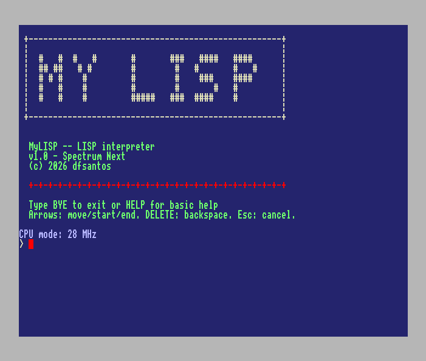
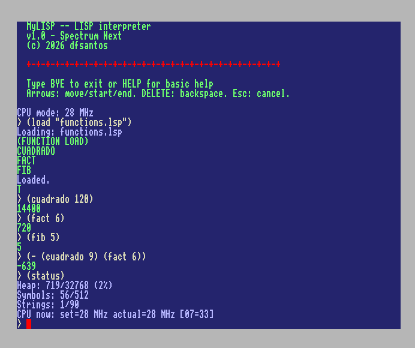

# MyLISP for ZX Spectrum Next — v1.0

MyLISP is a LISP-1 interpreter for the ZX Spectrum Next, written in C with
z88dk for NextZXOS. It includes lexical closures, an iterative evaluator,
paged memory, garbage collection and symbolic algebra examples.

It shares its design with the original [Sinclair QL version](https://github.com/dfernande132/MyLISP).



## Download and run

You need a ZX Spectrum Next running NextZXOS, or a compatible emulator such
as CSpect. No compiler is needed to run the supplied executable.

1. Download the repository using **Code → Download ZIP**, or download the
   binary package from Releases when available.
2. Copy `build/MyLISP.nex` and the `.lsp`/`.LSP` files from `examples/` into
   the same directory on your SD card or emulator filesystem.
3. Launch `MyLISP.nex` from the NextZXOS browser.
4. Type `HELP` for paginated help. Type `BYE` to finish.

```lisp
(+ 3 4)
(LOAD "CAS.LSP")
(LOAD "PCAS.LSP")
(STATUS)
```

The normal build requests 28 MHz. Startup reports the effective speed returned
by the machine. All code banks are included in the NEX; no separate bank files
are needed. BYE displays the farewell and stops in a final loop; it does not
return to BASIC. Use your usual restart procedure.

## Build from source

Requirements: Python 3 and a configured z88dk installation with the ZX Spectrum
Next classic target and esxDOS support. Put `zcc` and the other z88dk tools in PATH.

Reference compiler: `v25115-da80b5fe32-20260716`, source revision
`da80b5fe32839b8bd7935ade92e1644f05e8a8f0`. Other versions may produce different
code sizes or require adjustments.

Run from the project root:

```sh
python build.py
```

Use `python3 build.py` where Python 3 is named python3. The script creates
`build/` and generates `build/MyLISP.nex`, maps and intermediate files. It does
not require the internal development tests or documentation.

In VS Code, open the folder and press **Ctrl+Shift+B**. The task uses the same
source list. The supplied `build/MyLISP.nex` keeps the output directory present;
if you delete that directory, run build.py to recreate it.

Do not compile every C file at once: the wrappers in `src/bancos/` already
include several original modules and would cause duplicate definitions.

## Repository contents

| Path | Contents |
|---|---|
| `src/` | Interpreter, platform code and bank wrappers. |
| `.vscode/tasks.json` | Normal z88dk build configuration. |
| `build.py` | Python build entry point for Windows/Linux. |
| `build/MyLISP.nex` | Ready-to-run executable. |
| `examples/` | User programs and regression examples. |
| `screenshots/` | Images used by this README. |
| `LICENSE` | MIT license for sources and build configuration. |

Only the normal executable is distributed. Internal development history,
GC test fixtures and intermediate files are excluded from the public repository.

## Examples

- `BASIC.lsp`: types, lists and basic language examples.
- `FUNCTION.lsp`: user functions, including factorial and Fibonacci.
- `SORT.lsp`: recursive sorting.
- `ORDEN.lsp`: higher-order functions.
- `DERIVA.lsp`: symbolic differentiation.
- `CAS.LSP`: symbolic algebra and simplification.
- `PCAS.LSP`: examples and checks to run after CAS.LSP.
- `REGRESS.LSP`: language checks, including deliberate error cases. Inspect
  individual checks as well as the final message.



## Keyboard and commands

- Left/right move the cursor; typing inserts text.
- Up/down or Ctrl+A/Ctrl+E move to the start/end of the line.
- Spectrum DELETE erases the previous character; Ctrl+DELETE erases under cursor.
- Enter accepts a physical line. Expressions can continue across lines.
- Esc or CAPS SHIFT+SPACE cancels input or requests evaluation cancellation.
- `HELP` pauses every 20 content lines; press a key to continue. `(HELP)` also works.
- `(CLEAN)` collects garbage; `(STATUS)` reports resource usage and CPU status.
- `(SYMBOLS)` lists user definitions.
- `(NEW)` asks for confirmation and resets the session. Use it directly at
  the prompt; nested use is rejected.

Cancellation is cooperative: an individual primitive, printing operation,
GC pass or blocking I/O may finish first. Effects already performed are retained.

## Limits and known limitations

| Resource | Limit |
|---|---:|
| Heap | 32,768 cells of 8 bytes in 32 physical pages of 8 KB. |
| Distinct symbols | 512. |
| Simultaneous string entries | 90. |
| Symbol name | 8 characters; longer names are truncated. |
| String | 36 characters; longer strings are truncated. |
| Complete expression | 500 characters. |
| Evaluation task stack | 8,192 tasks. |

The iterative evaluator uses explicit tasks, but parsing, printing and some
list/GC operations still use C recursion. Deep structures can exhaust the native
Z80 stack; the iterative evaluator does not eliminate every native stack limit.

Automatic GC runs between expressions, at 80% occupancy in the REPL and 50%
during LOAD, considering heap cells and string entries. A single expression
can exhaust resources before the next collection point. After detected resource
exhaustion, the expression is abandoned, GC runs and control returns to the prompt.
Valid global definitions are retained; the expression is not retried.

GC reclaims unreachable cells and strings, but not interned symbols. Use NEW to
clear the symbol table. Nested LOAD is a known limitation: the reader shares state.

Integer and native z88dk floating-point arithmetic are supported. Rational literals
can be read, represented and printed and are recognized by NUMBERP; general
arithmetic primitives work on integers and floats, without full rational arithmetic.

## License and distribution

The source code in `src/`, `build.py` and `.vscode/tasks.json` is provided under
the [MIT license](LICENSE).

The supplied binary and documentation retain their Freeware terms: use for any
purpose, including commercial projects, and distribution unmodified are permitted.
Resale, repackaging or direct monetization of the supplied MyLISP software itself
is prohibited. These binary distribution terms do not restrict rights granted
for the MIT-licensed sources.

Example scripts in `examples/` are in the public domain; use and modify them freely.

## Version 1.0 highlights

- Banked code and resources, with a larger native stack reserve than prerelease 0.1.
- Safe string compaction and GC roots covering active evaluation tasks.
- Direct keyboard input, line editing and multiline cancellation.
- Cooperative evaluation cancellation and deferred session reset.
- Paginated help, QL-style banner and no separate loading screen.
- Configurable colors in `src/colors.h` and effective CPU-speed reporting.
- Resource exhaustion recovery, 512 symbols, 90 strings and 32,768 heap cells.
